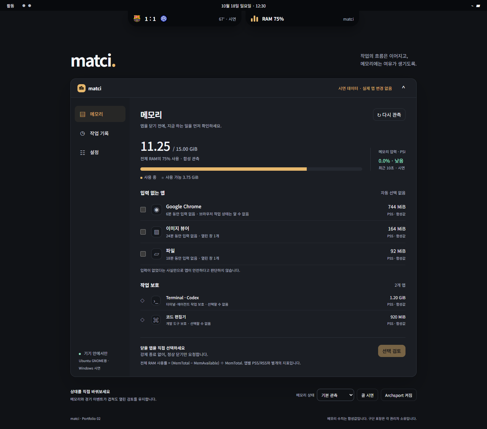

# matci

Ubuntu GNOME 패널에서 RAM을 살펴보고, 닫을 창을 직접 고릅니다.

전체 메모리와 앱별 사용량을 구별해 보여주고, 선택한 창에 정상 닫기를 요청합니다.



웹 시제품의 합성 데이터입니다. 실제 GNOME 화면과 창 닫기 검수는 별도로 진행합니다.

## Demo

저장소 루트에서 실행한 뒤 [로컬 시연](http://127.0.0.1:4180)을 엽니다. Python만 있으면 실행할 수 있습니다.

```sh
python -m http.server 4180 --bind 127.0.0.1 --directory web
```

## Install

GNOME Shell 50용 소스입니다. Python 3, GLib 스키마 도구, GNOME 확장 설정 도구가 필요합니다. 저장소 루트에서 실행합니다.

```sh
python3 tools/install_extension.py
```

## Quickstart

첫 설치 후 로그아웃하고 다시 로그인한 뒤 활성화합니다.

```sh
gnome-extensions enable matci@local
gnome-extensions prefs matci@local
```

패널의 RAM 항목이나 넘버패드 `Del`로 상세 화면을 엽니다. 닫을 앱을 선택하면 대상 창과 보호 이유를 먼저 검토합니다.

## 메모리 표시

- **전체 RAM:** `MemTotal − MemAvailable`을 기준으로 표시합니다.
- **앱별 메모리:** PSS를 우선 사용하고, RSS와 불완전 측정을 구별합니다.
- **작업 보호:** 시스템·Shell·터미널·개발 도구와 대상을 식별할 수 없는 창은 보호합니다.
- **닫기 기록:** 정상 닫기 요청 뒤 관측한 결과를 로컬에 남깁니다.

자동 종료, 강제 종료, 캐시 강제 비우기는 제공하지 않습니다. 앱별 수치를 확보 가능한 메모리로 해석하지 않습니다.

## 현재 상태

Windows 웹 시연과 WSL 수집 검증 기록이 있습니다. 실제 Ubuntu에서의 창 닫기·절전·배율·성능 검수는 남아 있습니다. [Archsport](https://github.com/halfsamoan/archsport)와 함께 쓸 때는 두 노치의 배치를 조정합니다.

[설치·업데이트·개발 절차](CONTRIBUTING.md) · [Linux 검수](docs/LINUX_HANDOFF.md) · [검증 기록](replica/verification.md)

## License

[MIT](LICENSE). 구단 표장은 각 권리자 소유이며 [출처 목록](web/assets/logos/manifest.json)을 따릅니다.
