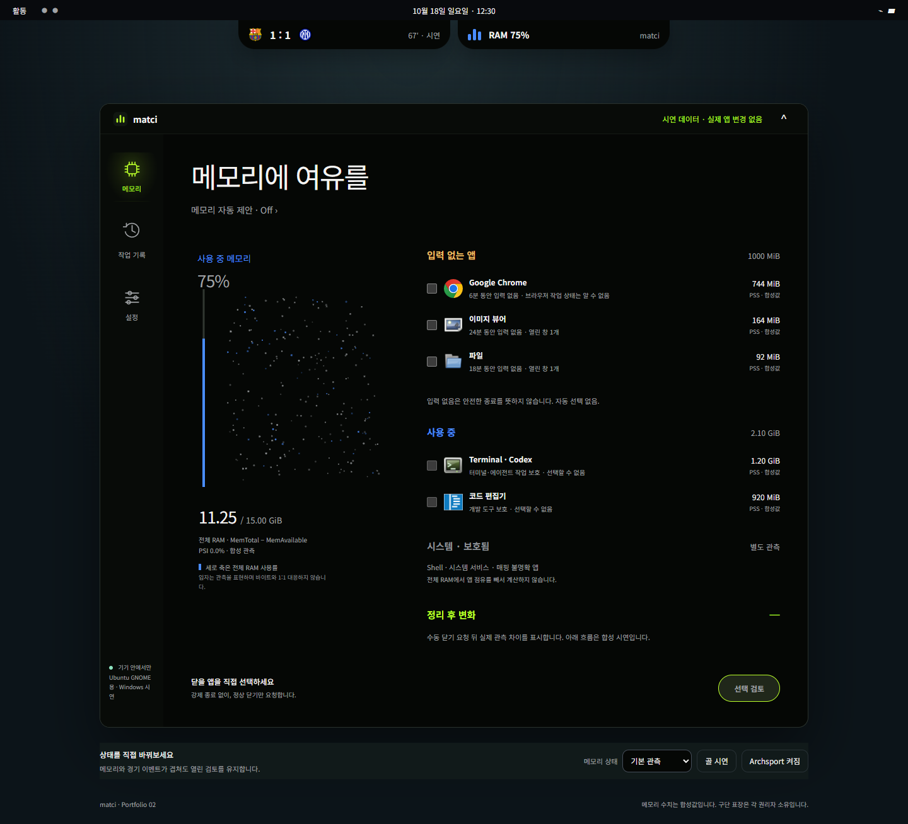

# matci — 포트폴리오 02

Ubuntu GNOME의 메모리 관측·수동 정리 도우미. Archsport와 함께 패널 아래 **두 개의 노치가 하나의 중앙 그룹으로 공존**한다.

matci와 [Archsport](https://github.com/halfsamoan/archsport)는 별도 앱·저장소다. 각각 설치·실행·제거하며, 두 노치를 함께 사용할 때 배치와 펼침 우선순위만 조율한다.

전체 RAM과 앱 점유를 구별해 보고, 보호 이유를 확인한 뒤 직접 선택한 앱의 창에 정상 닫기를 요청한다. 자동 종료·강제 종료·캐시 강제 비우기는 하지 않는다. Python core는 표준 라이브러리만 사용한다.

**현재: MVP 소스와 Windows 시연 구현. WSL의 실제 `/proc` 수집 및 자동 검사는 통과했으나, ASUS 노트북의 Ubuntu GNOME 실행·절전·배율·실제 창 닫기는 아직 미검증이다.** GNOME46/50은 선언한 검수 대상이지 확인된 호환성 목록이 아니다.

## Windows에서 보기

V2는 **큰 GTK4 독립 창**, 세로 메모리 축·입자 모션, yellow/blue/gray/lime 상태 색, 앱 GIcon, 자동 제안 popover와 아이콘 rail을 추가했다. 노치는 요약과 앱 진입을 담당한다.



[GTK4 렌더링 캡처](docs/screenshots/native-gtk-v2.png)는 WSL/Xvfb 합성 시연이다. 그 환경에 없는 앱은 일반 테마 아이콘이며 실제 설치 앱은 desktop entry의 GIcon을 사용한다. 원본 픽셀 측정이나 바이너리 분석 결과로 주장하지 않는다.

```powershell
python -m http.server 4180 --bind 127.0.0.1 --directory web
```

[시연 화면](http://127.0.0.1:4180)에서 두 노치·메모리 선택·검토·기록·설정을 확인한다. 합성 데이터이며 Windows 앱이나 실제 메모리는 변경하지 않는다.

## Ubuntu 설치

필요 패키지: `sudo apt install python3 libglib2.0-bin gjs gir1.2-gtk-4.0 gnome-shell-extension-prefs`.

설치 후 앱 목록의 **matci**, 패널 메뉴 또는 노치의 **앱 열기**로 큰 창을 연다. 창은 같은 확장에 연결한다. 확장이 꺼져 있으면 수치와 닫기를 비활성화하며 worker를 추가하지 않는다. GTK 검토도 기존 정상 닫기 gate를 통과한다.

```bash
python3 tools/doctor.py --output local-diagnostics/doctor.json
python3 -m unittest discover -s tests -v
glib-compile-schemas --strict --dry-run extension/schemas
python3 tools/install_extension.py
# 로그아웃·로그인 후
gnome-extensions enable matci@local
gnome-extensions prefs matci@local
```

업데이트는 `python3 tools/install_extension.py --upgrade`, 직전 버전 복구는 `--rollback`. 사용자 설정·DB는 확장 설치와 별도다. Archsport도 공존 버전으로 업데이트해야 공유 배치가 적용된다.

```bash
# 확장을 끈 상태에서 CLI를 분리 검사한다(기본 state에는 worker 1개만 허용).
gnome-extensions disable matci@local
python3 -m matci --once
# 키 없이 별도 상태에 합성 시연
python3 -m matci --mode demo --once --state-dir /tmp/matci-demo
gnome-extensions enable matci@local
```

## 구조와 검수

- GNOME Extension → Python subprocess, versioned JSON Lines. 별도 서비스·계정·네트워크 불필요.
- 수동 화면100 → 경기 알림80 → 메모리 제안30. 좁은 모니터는 패널 버튼으로 전환한다.
- [Linux 인수인계와 실기 절차](docs/LINUX_HANDOFF.md)
- [노치 공존 규칙](docs/DUAL_NOTCH.md)
- [독립 창과 디자인 V2 계약](docs/DESIGN_V2.md)
- [검증 기록과 한계](replica/verification.md)
- [최초 구현 계획](docs/IMPLEMENTATION_PLAN.md) · [원본 조사](replica/recon.md)

디스크·폴더 정리·패키지 제거는 후속 범위다. 참고 사진은 연구용이며 실행 패키지에 포함하지 않는다. 구단 표장은 각 권리자 소유이고 출처는 `web/assets/logos/manifest.json`에 기록했다.
